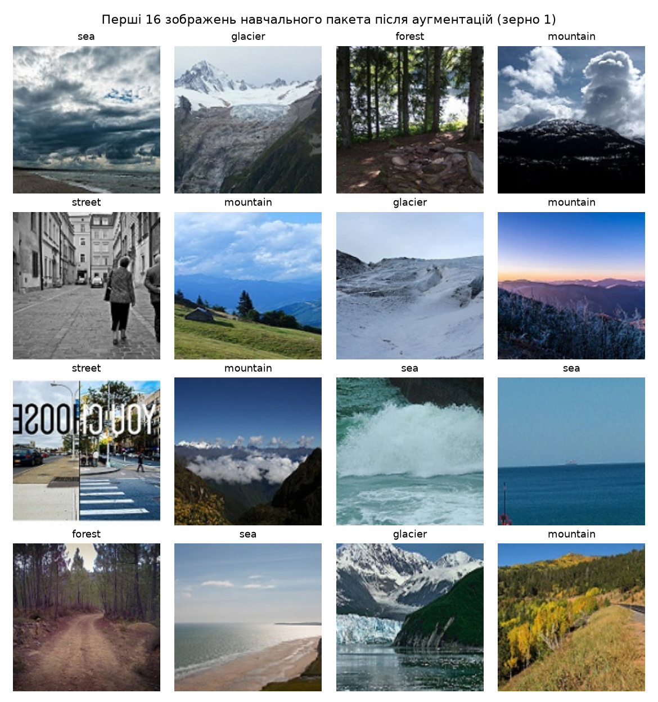
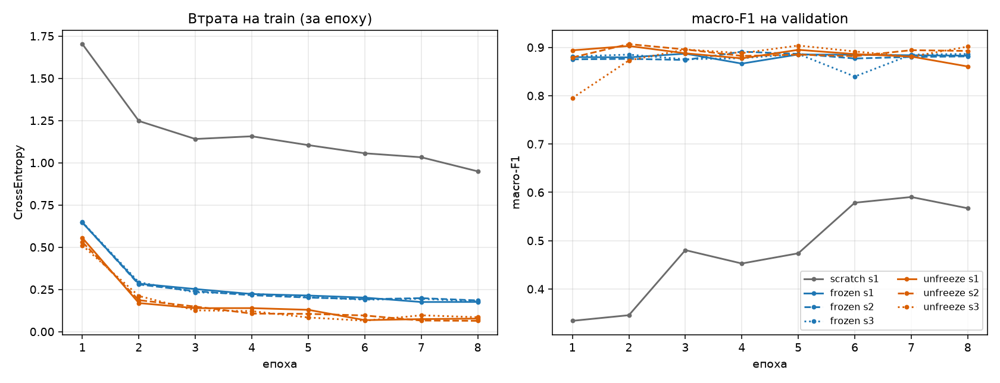
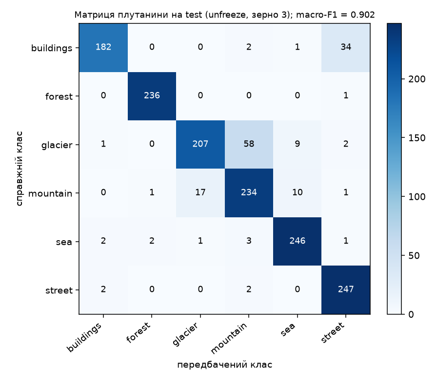
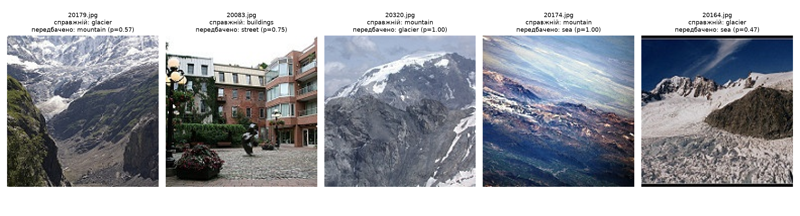

# ЛР3. Обчислювальний експеримент і трансферне навчання (ResNet-18, Intel Image Classification)

Порівняно три режими навчання ResNet-18 на 1200 зображеннях (200 на клас) за однакового бюджету в 304 кроки оптимізатора: **scratch** (випадкова ініціалізація), **frozen** (заморожений кістяк ImageNet, навчається лише `fc`) і **unfreeze** (додатково розморожено `layer4` із меншою швидкістю навчання).

## Як запустити

```
uv run train.py    --data <шлях до теки, що містить seg_train/ і seg_test/>
uv run analyze.py  --data <той самий шлях>
```

- `train.py`: поділ → контрольна таблиця → перевірки пп. 1–2 → сім запусків → вибір за validation → `lab3_model.pt`. Тестові зображення не завантажуються. Ключі: `--resume` (пропустити готові запуски), `--weights-file` (локальний файл ваг, див. «Відхилення»).
- `analyze.py`: перевірка хешу `split.csv` у журналах → таблиця, криві, ефекти, перевірка вибору → **єдина** тестова оцінка на CPU, матриця плутанини, п'ять помилок. Результат також пишеться в `analysis/results.md` та `analysis/results.json`. Усі тестові числа нижче взято з виводу цієї команди.
- Версії зафіксовано в `pyproject.toml` (+ `uv.lock`). Файл ваг `resnet18-f37072fd.pth` покладіть у цю теку або дозвольте torchvision завантажити його сам.

Файли: `split.csv`, `runs/<режим>_seed<зерно>/{run.json,val_logits.npy}`, `lab3_model.pt` (вибраний запуск), `checks.json`, `analysis/`, рисунки `fig_batch.png`, `fig_curves.png`, `fig_confusion.png`, `fig_errors.png`. Набір даних до репозиторію не входить.

---

## 1. Перевірки до навчання

### Поділ

Контрольна таблиця для мого `split.csv` (кількість / сума числових імен). **Збіглися всі 18 клітинок і підсумкові рядки**, жоден файл не входить у дві частини. SHA-256 `split.csv`: `8407b14dde8eca5816a9f3e34347be54ea19c4a9a35163cb2bf7507a045279d9`.

| Клас | train | validation | test | збіг |
|---|---|---|---|---|
| buildings | 200 / 1 996 761 | 218 / 4 837 323 | 219 / 4 837 559 | так |
| forest | 200 / 2 032 625 | 237 / 5 276 962 | 237 / 5 291 326 | так |
| glacier | 200 / 2 183 923 | 276 / 6 135 652 | 277 / 6 157 250 | так |
| mountain | 200 / 1 950 345 | 262 / 5 789 535 | 263 / 5 849 765 | так |
| sea | 200 / 1 987 613 | 255 / 5 655 068 | 255 / 5 668 011 | так |
| street | 200 / 1 841 817 | 250 / 5 541 845 | 251 / 5 547 533 | так |
| Разом | 1200 / 11 993 084 | 1498 / 33 236 385 | 1502 / 33 351 444 | так |

### Пакет після перетворень



Видно обрізання з масштабуванням і дзеркальне відбиття (наприклад, напис на зображенні «street» у третьому рядку), мітки відповідають вмісту.

### Початкова втрата L0 (зерно 1, перший навчальний пакет, без кроків оптимізатора)

| Режим | L0 | ln 6 |
|---|---|---|
| scratch | 2.134 | 1,792 |
| frozen | 2.216 | 1,792 |

Обидва значення **вищі за ln 6**. ln 6 є втратою моделі, яка дає всім класам однакову ймовірність, а початкова модель такою не є: голова `Linear(512, 6)` зі стандартною ініціалізацією дає *різні* випадкові логіти, тому її очікувана втрата перевищує ln 6 (нерівність Єнсена: випадковий розкид логітів, не пов'язаний з мітками, лише збільшує середню крос-ентропію). Виміряно: стандартне відхилення логітів 0,50 (scratch) і 0,67 (frozen). Для frozen розкид більший, бо ознаки ImageNet після усереднювального пулінгу мають більшу норму (≈27,9 проти ≈18,7 у scratch), а випадкова голова на них дає більші за модулем логіти. У scratch модель на цьому пакеті майже завжди передбачає клас `buildings` (27 із 32), що також відхиляє втрату від ln 6. Розбіжностей з очікуваним немає: втрата одного порядку з ln 6, не NaN і не нуль.

## 2. Перевірки режимів навчання

### Параметри

| Режим | Усього параметрів | requires_grad=True | Групи оптимізатора (параметрів, lr) | Збігається з таблицею | requires_grad=False в оптимізаторі |
|---|---|---|---|---|---|
| scratch | 11 179 590 | 11 179 590 | 11 179 590 (lr=0.003) | так | немає |
| frozen | 11 179 590 | 3 078 | 3 078 (lr=0.003) | так | немає |
| unfreeze | 11 179 590 | 8 396 806 | 3 078 (lr=0.003); 8 393 728 (lr=0.0003) | так | немає |

Кількості збігаються з таблицею режимів (11 179 590 / 3 078 / 8 396 806; layer4 дає 8 393 728 + fc 3 078). Жоден параметр із `requires_grad=False` в оптимізатор не потрапив, суми груп дорівнюють кількості параметрів, що навчаються.

### Що змінюється під час навчання (5 кроків, `set_train_mode`, точне порівняння `torch.equal`)

**frozen** (очікувано: незмінні `conv1, bn1, layer1–layer4`; змінюється лише `fc`):

| Модуль | Параметри змінилися | Ковзні статистики BN змінилися | Збігається з очікуваним |
|---|---|---|---|
| conv1 | ні | немає BN | так |
| bn1 | ні | ні | так |
| layer1 | ні | ні | так |
| layer2 | ні | ні | так |
| layer3 | ні | ні | так |
| layer4 | ні | ні | так |
| fc | так | немає BN | так |

**unfreeze** (очікувано: незмінні `conv1, bn1, layer1–layer3`; змінюються `layer4` і `fc`):

| Модуль | Параметри змінилися | Ковзні статистики BN змінилися | Збігається з очікуваним |
|---|---|---|---|
| conv1 | ні | немає BN | так |
| bn1 | ні | ні | так |
| layer1 | ні | ні | так |
| layer2 | ні | ні | так |
| layer3 | ні | ні | так |
| layer4 | так | так | так |
| fc | так | немає BN | так |

Усі рядки збіглися з очікуваним, після чого перейшов до основного експерименту.

### Дослід із навмисною помилкою (frozen, `model.train()` замість `set_train_mode`)

**Прогноз, записаний до запуску** (текст у `train.py`, змінна `BN_PREDICTION`): параметри всього кістяка не зміняться (`requires_grad=False`, у оптимізаторі їх немає), а ковзні статистики BN у `bn1` та `layer1–layer4` зміняться, бо їх оновлює сам прямий прохід у режимі train(). Змінюватиметься лише `fc`. З кривої втрати на train це майже не видно, бо кістяк просто нормує пакетними статистиками; наслідок мав би проявитися на validation/test, де BN бере накопичені, зсунуті статистики.

**Результат:**

| Модуль | Параметри змінилися | Ковзні статистики BN змінилися | Збігається з прогнозом |
|---|---|---|---|
| conv1 | ні | немає BN | так |
| bn1 | ні | так | так |
| layer1 | ні | так | так |
| layer2 | ні | так | так |
| layer3 | ні | так | так |
| layer4 | ні | так | так |
| fc | так | немає BN | так |

Прогноз підтвердився повністю. Максимальна абсолютна зміна в `layer1.0.bn1` після 5 кроків: `running_mean` — **0.0886**, `running_var` — **0.1484** (при коректному `set_train_mode` обидві дорівнюють 0). Частину прогнозу про вплив на криву втрати я перевірив лише на рівні міркування: повного навчання з цією помилкою я не запускав, тож її вплив на F1 тут не виміряно.

**Чому `requires_grad=False` не захищає ці значення.** `running_mean` і `running_var` не є параметрами, це буфери. Їх не торкаються ні градієнти, ні оптимізатор. Їх оновлює безпосередньо прямий прохід BN у режимі `train()` за формулою `ŝ ← (1−m)·ŝ + m·s_пакета` (m = 0,1), тож захистити їх може лише `eval()` для цих модулів. За 5 кроків статистики вже на ≈41 % (1 − 0,9⁵) зсунуті до пакетних. Для frozen це шкідливо: ознаки ImageNet на виході кістяка поступово дрейфують до статистик малої, аугментованої вибірки, а голова тим часом навчається на інших ознаках, ніж побачить на validation. **Для `layer4` у режимі unfreeze** оновлення правильне: ваги цього блока змінюються, тож і розподіл його активацій змінюється, і ковзні статистики мають йти за ним; інакше на виведенні BN нормував би виходи нових ваг старими статистиками ImageNet, які їм уже не відповідають.

## 3. Сім запусків

| # | Режим | Зерно | Втрата train, епоха 8 | macro-F1 validation, епоха 8 | Час навчання, с |
|---|---|---|---|---|---|
| 1 | scratch | 1 | 0.9490 | 0.5671 | 265 |
| 2 | frozen | 1 | 0.1759 | 0.8829 | 81 |
| 3 | frozen | 2 | 0.1848 | 0.8814 | 81 |
| 4 | frozen | 3 | 0.1788 | 0.8864 | 79 |
| 5 | unfreeze | 1 | 0.0772 | 0.8605 | 113 |
| 6 | unfreeze | 2 | 0.0640 | 0.8927 | 110 |
| 7 | unfreeze | 3 | 0.0854 | 0.9015 | 114 |

«Час навчання» — сума часу 8 епох навчання без валідації (повний час із валідацією — у `run.json`, поле `total_wall_time_s_with_validation`). У `run.json` кожного запуску: зерно, усі налаштування з розділів «Перетворення», «Модель і режими», «Цикл навчання» (включно зі значеннями за замовчуванням AdamW), хеш коміту й позначка про незакомічені зміни, SHA-256 `split.csv`, версії Python/PyTorch/torchvision, пристрій, втрата train і macro-F1 validation за кожну епоху, час навчання. Логіти validation після 8-ї епохи — у `val_logits.npy` (1498 × 6). Орієнтир із завдання виконано: frozen ≈ 0,88 (0,881–0,886), scratch помітно нижче й далеко від 1/6.



## 4. Розклад ефектів

Формули: F̄_r = (1/3)·Σ_s F_{r,s}; R_r = max_s F_{r,s} − min_s F_{r,s}; R = max(R_frozen, R_unfreeze); Δ_pre = F̄_frozen − F_{scratch,1}; Δ_unf = F̄_unfreeze − F̄_frozen; Δ_pre + Δ_unf = F̄_unfreeze − F_{scratch,1}.

| Величина | Значення |
|---|---|
| F̄_frozen, R_frozen | 0.8836, 0.0051 |
| F̄_unfreeze, R_unfreeze | 0.8849, 0.0410 |
| F_scratch,1 | 0.5671 |
| R = max(R_frozen, R_unfreeze) | 0.0410 |
| Δ_pre = F̄_frozen − F_scratch,1 | +0.3165 (+31.6 п. macro-F1) |
| Δ_unf = F̄_unfreeze − F̄_frozen | +0.0013 (+0.1 п. macro-F1) |
| Δ_pre + Δ_unf = F̄_unfreeze − F_scratch,1 | +0.3178 (+31.8 п.) |

Окремі значення: frozen 0,8829 / 0,8814 / 0,8864; unfreeze 0,8605 / 0,8927 / 0,9015.

- **Δ_pre = +0,3165 (+31,6 п.), R = 0,0410:** |Δ_pre| > R (приблизно у 7,7 раза), ефект вартий перевірки, але не доведений.
- **Δ_unf = +0,0013 (+0,1 п.), R = 0,0410:** |Δ_unf| ≤ R, різниця **не відрізняється від розкиду, результату немає**.

**Що змінює зерно в кожному режимі.** У всіх режимах воно задає початкові ваги голови `fc` (`Linear(512, 6)`), порядок пакетів у `shuffle=True` і випадкові параметри аугментацій. У scratch воно додатково задає ініціалізацію *всієї* мережі (11,2 млн ваг), а у frozen і unfreeze кістяк однаковий для всіх зерен, бо береться з ваг ImageNet. Розкид у frozen і unfreeze відрізняється тому, що в frozen навчається лише лінійна голова на *фіксованих* ознаках (задача майже опукла, а BN не змінюється): R_frozen = 0,0051. В unfreeze оптимізується ще 8,4 млн ваг `layer4` разом зі статистиками BN, траєкторія значно чутливіша до порядку пакетів, а F1 на 8-й епосі є одним значенням без вибору епохи; крива показує коливання від епохи до епохи на 1–3 п. (наприклад, зерно 1: 0,894 → 0,860 за 8 епох), тож R_unfreeze = 0,0410 майже у 8 разів більший.

**Чому R із запусків 2–7 не характеризує розкид запуску 1.** R виміряно лише для режимів, де кістяк той самий і змінюється голова/layer4. У scratch зерно змінює всю ініціалізацію, тож розкид між зернами в нього, імовірно, значно більший, а ми маємо одне значення й не знаємо його. Крива запуску 1 це підтверджує: macro-F1 стрибає (0,453 на епосі 4 → 0,579 на епосі 6, потім 0,590 → 0,567), втрата train ще падає й на 8-й епосі дорівнює 0,949 (проти 0,06–0,18 в інших), тобто scratch за 304 кроки далекий від збіжності. Висновок щодо Δ_pre це **не змінює**: різниця 31,6 п. набагато перевищує навіть кілька R; змінюється лише точність оцінки величини, і слід пам'ятати, що це відставання за конкретного бюджету.

**Чи однаковий бюджет за часом.** За кількістю кроків бюджет однаковий (304), за часом ні: scratch ≈ 265 с, frozen ≈ 80 с (81 / 81 / 79), unfreeze ≈ 112 с (113 / 110 / 114). Frozen не рахує градієнтів кістяка, unfreeze рахує їх лише для `layer4`, scratch — для всієї мережі. Тому frozen у 3,3 разу швидший за scratch і в 1,4 разу за unfreeze. Час виміряно на 2 потоках CPU в спільному середовищі, тож абсолютні числа приблизні, а співвідношення стабільні між зернами.

## 5. Вибір конфігурації і тестова оцінка

Вибір лише за validation (у команді навчання, перевіряється в аналізі за журналами):

| Режим | F̄_r (для scratch - F_scratch,1) |
|---|---|
| scratch | 0.5671 |
| frozen | 0.8836 |
| unfreeze | 0.8849 |

Вибрано режим **unfreeze**, запуск із найбільшим F: **зерно 3** (F = 0,9015); `lab3_model.pt` (ключі `state_dict, regime, seed, classes, img_size=160`) відповідає цьому правилу. Оскільки |Δ_unf| ≤ R, **вибір між frozen і unfreeze визначив шум**: середні відрізняються на 0,13 п., а розкид — 4,1 п. Процедуру це не змінює, але перевагу unfreeze над frozen доведеною вважати не можна.

### Test (один раз, CPU, команда аналізу)

- macro-F1 на test: **0.9016**; accuracy: 0.9001; n = 1502.
- F вибраного запуску на validation: 0,9015, різниця test − validation = +0,0001.
- Стандартна похибка частки правильних √(p(1−p)/n) = **0.0077** (≈ 0,77 п.).

Матриця плутанини (рядки — справжній клас, стовпці — передбачений):

| справжній \ передбачений | buildings | forest | glacier | mountain | sea | street |
|---|---|---|---|---|---|---|
| buildings | 182 | 0 | 0 | 2 | 1 | 34 |
| forest | 0 | 236 | 0 | 0 | 0 | 1 |
| glacier | 1 | 0 | 207 | 58 | 9 | 2 |
| mountain | 0 | 1 | 17 | 234 | 10 | 1 |
| sea | 2 | 2 | 1 | 3 | 246 | 1 |
| street | 2 | 0 | 0 | 2 | 0 | 247 |



**Чи видно зміщення відбору?** Вибір найкращого з трьох запусків робить валідаційне число оптимістичним: за розкиду R_unfreeze ≈ 4 п. очікуване зміщення найкращого з трьох над типовим запуском становить порядку 1–2 п. Але у наших числах його **не видно**: test (0,9016) практично дорівнює validation (0,9015), різниця +0,01 п. Це не суперечить зміщенню, бо шум скінченності вибірки сам по собі ≈ 0,8 п. на кожній половині (для різниці двох незалежних половин ≈ 1,1 п.), тобто різниця +0,01 п. міститься в межах цього шуму, а зміщення того ж порядку, що й шум, на одній вибірці розрізнити неможливо. Зміщення може навіть мати протилежний знак: validation і test — різні половини, і на test вибрана модель могла просто потрапити в «легшу» підмножину; крім того, validation-оцінка найкращого запуску включає й шум самого запуску (зерно 3 мало на 8-й епосі +1,7 п. над середнім unfreeze), який на test не обов'язково повторюється.

### П'ять характерних помилок

| Файл | Справжній клас | Передбачений клас | Імовірність передбаченого класу | Кількість таких помилок у test |
|---|---|---|---|---|
| 20179.jpg | glacier | mountain | 0.565 | 58 |
| 20083.jpg | buildings | street | 0.745 | 34 |
| 20320.jpg | mountain | glacier | 0.998 | 17 |
| 20174.jpg | mountain | sea | 0.998 | 10 |
| 20164.jpg | glacier | sea | 0.469 | 9 |



Категорії (моя візуальна оцінка кожного зображення):

1. `20179.jpg`, glacier → mountain (p = 0,57): **сцена містить обидва класи**: льодовиковий язик у долині, оточений скелястими схилами.
2. `20083.jpg`, buildings → street (p = 0,75): **сцена містить обидва класи**: будинки обабіч бруківкою вимощеного двору з ліхтарями, тобто фактично вулиця між будівлями.
3. `20320.jpg`, mountain → glacier (p = 0,998): **помилка моделі на однозначному зображенні**: це скеляста гора лише з плямами снігу, модель упевнено сприйняла сніг як ознаку льодовика.
4. `20174.jpg`, mountain → sea (p = 0,998): **помилка моделі на однозначному зображенні** (нетиповий похилий вигляд гір із висоти), у якому сині відтінки неба та хмар навели на «море».
5. `20164.jpg`, glacier → sea (p = 0,47): **помилка моделі на однозначному зображенні**: це льодовик (крижане поле), модель невпевнена, ймовірно через темно-синє небо й чорні смуги по краях кадру.

Найчастіша пара — glacier → mountain (58 випадків) — це **властивість набору**, а не дефект моделі: на фото льодовиків майже завжди є гори, а на горах лежить сніг. Її не виправляв.

## 6. Висновок

Обидва ефекти виміряно **за конкретного бюджету в 304 кроки** (8 епох, 1200 зображень): за довшого навчання scratch міг би скоротити відставання.

**Δ_pre (ефект попередньо навчених ознак).** Напрям: на користь попереднього навчання. Величина: **+31,6 п. macro-F1** (frozen 0,8836 проти scratch 0,5671). Співвідношення з розкидом: |Δ_pre| = 0,3165 при R = 0,0410, тобто ≈ 7,7·R, отже |Δ_pre| > R: ефект вартий перевірки, але не доведений. Для scratch є лише один запуск, тож його власний розкид невідомий (див. п. 4).

**Δ_unf (ефект донавчання кістяка).** Напрям: формально додатний, але **величина +0,13 п. macro-F1** (unfreeze 0,8849 проти frozen 0,8836) при R = 0,0410, тобто |Δ_unf| ≈ 0,03·R ≤ R: **різниця не відрізняється від розкиду, результату немає**. Те, що зерно 3 unfreeze дало найкращу модель (0,9015), — вибір найкращого з трьох, а не ефект режиму; найгірший запуск unfreeze (0,8605) гірший за будь-який frozen. Донавчання `layer4` суттєво знижує втрату на train (≈ 0,06–0,09 проти ≈ 0,18), але на validation цього виграшу не видно.

**Для нової задачі з 200 зображеннями на клас** я взяв би **frozen**: він дає ту саму якість, що й unfreeze, у межах розкиду (0,884 проти 0,885), у 8 разів менший розкид між зернами (R = 0,005 проти 0,041) і на ≈ 30 % швидший (80 с проти 112 с); unfreeze варто брати лише тоді, коли є кілька зерен і час для їх порівняння на validation.

---

## Відхилення від фіксованих налаштувань та інші примітки (задекларовано)

1. **Ваги ImageNet.** Середовище, де я виконував роботу, не мало доступу до `download.pytorch.org` (403), тому `resnet18-f37072fd.pth` (SHA-256 `f37072fd47e89c5e827621c5baffa7500819f7896bbacec160b1a16c560e07ec`) завантажено на ПК користувача через torchvision і завантажується з локального файлу (`resnet18(weights=None)` + `load_state_dict`) замість `weights=ResNet18_Weights.IMAGENET1K_V1`. Це ті самі ваги (контрольна сума збігається з іменем файлу). Конструктор споживає генератор випадкових чисел так само, тож решта процедури (ініціалізація голови, порядок пакетів) не змінюється. Без файлу в теці `train.py` використовує `weights=ResNet18_Weights.IMAGENET1K_V1`.
2. **Середовище виконання.** Навчання й тест виконано на CPU (2 потоки) у хмарному середовищі, Python 3.12.3, torch 2.15.0+cu132 і torchvision 0.29.2+cu132 (збірки з PyPI; CUDA не використовувалась), float32. Версії інших бібліотек закріплено в `pyproject.toml`. Значення macro-F1 на іншій апаратурі можуть дещо відрізнятися.
3. **Коміти.** Журнали запусків 2–7 мають коміт `a6bb107`, журнал запуску 1 (scratch) — `673806d` із позначкою «є незакомічені зміни»: на той момент у теці був ще не доданий до git `analyze.py`, який у навчанні не бере участі. Між цими комітами змінено лише очікуваний префікс контрольної суми файлу ваг (виправлення моєї помилки в імені файлу), що на scratch не впливає. Хеші стосуються локального git-репозиторію, створеного в середовищі виконання; у вашому репозиторії ЛР вони будуть іншими.
4. **Порядок виконання.** Перевірки пп. 1–2 виконано на реальних вагах до запусків 2–7 (усі збіглися). Запуск 1 (scratch) я почав раніше, поки чекав файл ваг, бо йому ваги не потрібні; перевірки для scratch (кількості параметрів і L0) від ваг не залежать.
5. **Налагодження.** До основних запусків я запускав лише пробну перевірку коду з випадковими вагами (прапорець `--debug-no-pretrained`, вивід у тимчасову теку): ці результати в таблицю й у вибір не входять. `analyze.py` відмовляється працювати з такими журналами.
6. **Перезапуск запуску 7.** Після перезапуску середовища запуск 7 (unfreeze, зерно 3) довелося почати з нуля; значення епох 1–7 повністю збіглися з перерваним запуском, що підтверджує детермінованість на CPU.
7. **Кеш зображень.** Зображення відкриваються через Pillow `.convert("RGB")` один раз і зберігаються в пам'яті до перетворень (на результат це не впливає).
8. **Ваги інших запусків** (`runs/*/weights.pt`) до репозиторію не додаються (див. `.gitignore`); у репозиторії лише `lab3_model.pt` вибраного запуску.

## Використані інструменти

Роботу виконано за допомогою Claude (Anthropic) у середовищі Cowork: код, запуски та текст звіту; користувач надав дані, ваги й перевірив результат. Використано матеріал лекцій 5–7: нормування й режими `train()`/`eval()` для BN (заморожування статистик, бонус Б5 лекції 5), AdamW зі спадом ваг, підрахунок параметрів ResNet-18 за стадіями (лекція 7) і правило порівняння з розкидом між зернами. Я пояснюю і можу відтворити кожну частину коду та числа.
